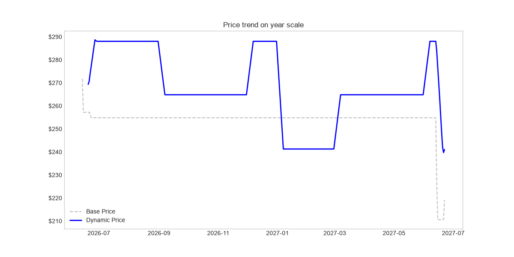
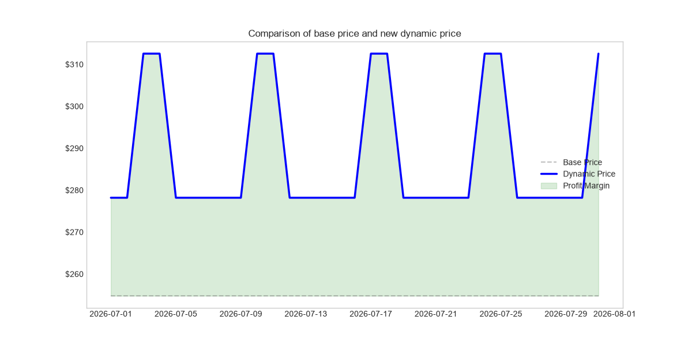

# 🗽 NYC Airbnb Dynamic Pricing Engine

## 📌 Project Overview
This repository contains data-driven pricing engine designed specifically for the New York City rental market. The core objective of this project is to replace inefficient, static prices with an algorithmic pricing model. The engine dynamically optimizes nightly rates by interpreting market conditions which includes season multipliers, day-of-week premiums and last minute discounts

## 💰 Business Impact & ROI

To validate the financial viability of the algorithm, an A/B test simulation was conducted, comparing historical static pricing against generated dynamic rates. After strictly normalizing the baseline data to eliminate artificial outlliers and extreme values, the financial simulation demonstrated a highly profitable outcome.

### Key Results:
* **Projected Revenue Increase:** The algorithmic pricing model generated **+5.34%** ROI compared to static approach

* **Strategic Market Responsiveness:** The engine successfully capitalizes on high-demand periods (e.g., summer peaks and holiday weekends) while strategically lowering baseline prices during off-peak windows.

### Visual Proof of Concept

*(Yearly chart of seasonality)*

*(Closer look on green zone of generated margin from day-of-week premiums during july)*

## 🛠 Tech Stack
* **Language:** Python 3.x
* **Data Processing:** Pandas, NumPy
* **Data Visualization:** Matplotlib
